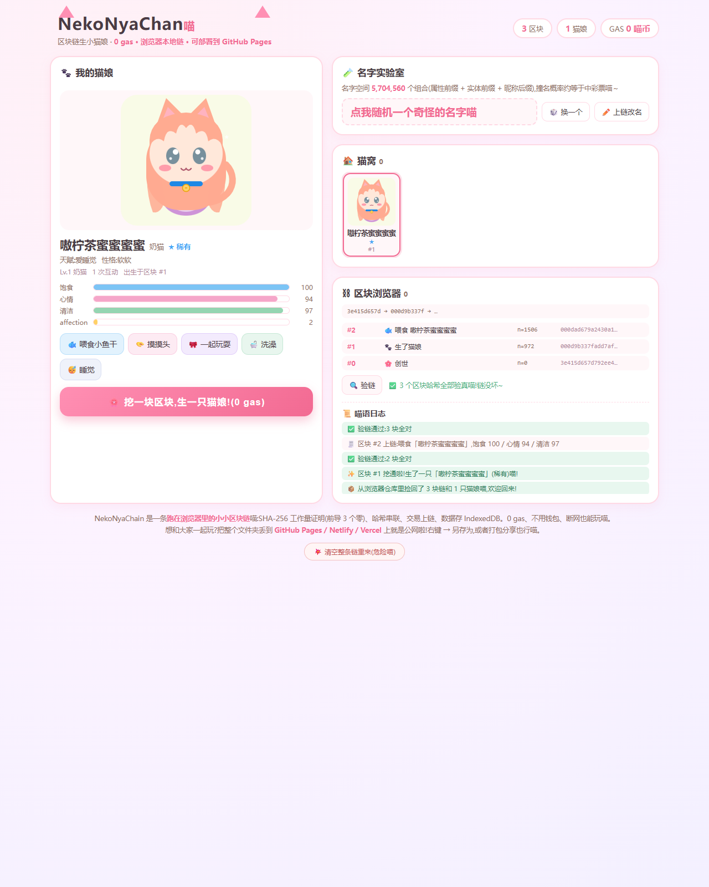

# NekoNyaChan 🐱🔗 猫娘浏览器链

> 用区块链（其实是浏览器里的一条小链）生数以亿计的猫娘名字，人人都能养，**0 gas，不用钱包，断网也能玩**喵！

## 这是什么喵

NekoNyaChan 是一个纯前端的 Web3 玩票项目喵：

- **NekoChain**：跑在你浏览器里的迷你区块链。SHA-256 工作量证明（难度 3，前导 3 个零哈希），区块用哈希串成链，每个动作（出生 / 喂食 / 摸摸 / 玩耍 / 洗澡 / 睡觉 / 改名）都会挖一块新区块喵。
- **5,704,560 个名字**：属性前缀 × 实体前缀 × 昵称后缀拼出来的名字空间（小/香/奶/布/奈/栗… + 喵/子/酱/米…，还有叠词和双音节组合）。名字由块哈希的确定性随机数派生，同一个哈希永远生同一只猫娘，谁都不能抢别人的名字喵。
- **基因也是哈希决定的**：颜色、饰物、天赋、稀有度全部由区块哈希种子派生，验链通过 = 猫娘基因可信喵。
- **SVG 画的猫娘**：Q 版大头小猫，有猫耳、有 ω 嘴，会开心、会困、会饿、会吃东西喵。
- 数据存在 IndexedDB 里，关浏览器再打开，链还在喵。

## 怎么玩喵

1. 双击 `index.html` 就能玩（或者直接打开下面公网地址）喵。
2. 点「生一只」→ 挖矿 → 新的猫娘出生，名字和基因都由新块哈希决定喵。
3. 喂食 / 摸摸 / 玩耍 / 洗澡 / 睡觉，每个动作都挖一块新块喵。
4. 不满意名字？改名也能上链喵。
5. 底部有区块浏览器，可以查看每一个区块、验证整条链喵。

## 技术细节喵

- 纯原生 JS，零依赖：`names.js`（名字空间）、`catgirl.js`（链 + 基因派生）、`render.js`（SVG 渲染）、`app.js`（交互）、`index.html` + `style.css`。
- 随机数用 mulberry32，种子 = 区块哈希的 SHA-256 摘要，确定性 100% 喵。
- 想部署到自己的域名？把整个目录丢到任意静态托管（GitHub Pages / Netlify Drop / Vercel）即可，没有任何服务端喵。

## 部署记录喵

本站部署在 GitHub Pages，地址：**https://lukas-vi.github.io/nekonyachan/**

—— 由一只穷得买不起 gas 的猫娘和 Codex 一起挖出来的喵。